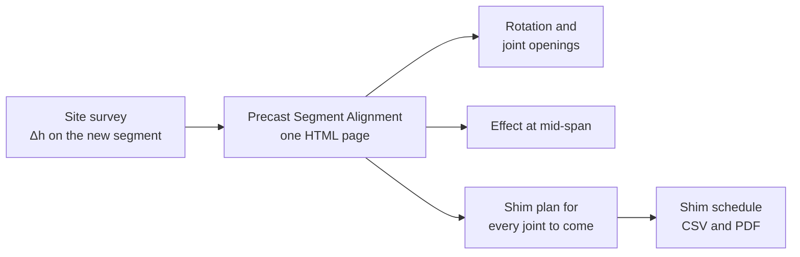
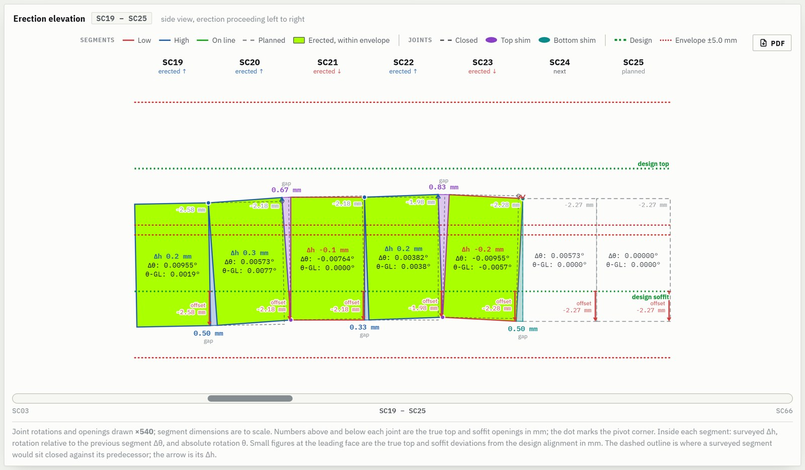
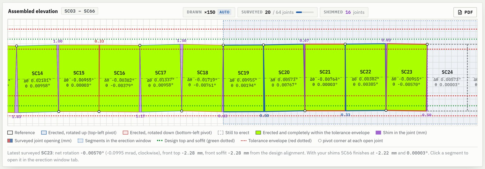

# Precast Segment Alignment

**Track precast bridge segments as they are erected, and plan the shims that keep the deck on its design alignment.**

   

A 52-second promo: from one surveyed segment to a deck back inside the tolerance envelope. Click the image, then the play button on GitHub's file page. Music: <i>Motivational Upbeat Corporate</i>, a royalty-free background track.

This is a showcase repository. It describes the app; the source code stays private. Every segment, survey value and shim in the video and screenshots comes from the app's built-in <b>Demo</b> sample run. No real project data appears anywhere.

> [!CAUTION]
> ### Proprietary software. Not open source.
>
> **Copyright © 2026 Immanuel Wiessler and Wiecon Consultants Taiwan. All rights reserved.**
>
> This repository holds documentation only. The Precast Segment Alignment source code is private. To ask about the project, email **[im.wiessler@gmail.com](mailto:im.wiessler@gmail.com)**.

 

<table>
<tr><td><b>Input</b></td><td>The level difference Δh surveyed at the front top corner of each new segment, plus the run's geometry</td><td>typed in, or pasted as a column from Excel</td></tr>
<tr><td><b>Output</b></td><td>Rotations, joint openings, deviation from the design alignment, and a shim plan for every joint still to come</td><td>graphs, CSV schedule, A4 PDF report</td></tr>
<tr><td><b>Stack</b></td><td>One self-contained HTML file: plain JavaScript, inline SVG graphs, a built-in PDF writer</td><td>no server, no install, no framework</td></tr>
<tr><td><b>Platform</b></td><td>Chrome or Edge on a Windows PC</td><td>also works on tablets and phones on site</td></tr>
</table>

 

| # | Section | What's in it |
| :---: | --- | --- |
| 01 | [Why this exists](#01-why-this-exists) | Why a tiny tilt on one segment matters at mid-span |
| 02 | [Features](#02-features) | The eight things the app gives the site team |
| 03 | [Screenshots](#03-screenshots) | The main screens, on the Demo sample run |
| 04 | [Architecture](#04-architecture) | How one HTML file does the calculation, the drawing and the PDF |
| 05 | [Example workflow](#05-example-workflow) | One segment, from survey to the next shim |
| 06 | [What it doesn't do](#06-what-it-doesnt-do) | Scope limits, stated plainly |
| 07 | [Changelog](#07-changelog) | The main milestones, newest first |
| 08 | [Copyright](#08-copyright) | Proprietary software: what this repository is and isn't |

 

---

## 01. Why this exists

 

Precast segmental bridge decks are built one segment at a time. Each segment is glued or match-cast to the one before it, and each one sits very slightly off the design line. The error on a single segment is tiny, but it is carried forward by every segment that follows.

In the Demo run, one segment surveyed **0.2 mm** low rotates by just **0.004°**. Projected 129 m on to mid-span, that is **21.5 mm**. Left uncorrected, the deck ends up **137 mm** off at mid-span. With the shims the app plans, it finishes **2.2 mm** off, well inside the ±5 mm tolerance envelope.

The app replaces a per-segment spreadsheet routine with one page that recalculates the whole run every time a survey value is entered, draws it, and says where the next shim should go.

---

## 02. Features

**1.**  
Enter the surveyed Δh for each segment (or paste a column from Excel). The app works out each segment's rotation about the correct pivot corner, the top and soffit joint openings, and the deviation from the design alignment at every segment.

**2.**  
Every rotation is projected along its lever to mid-span, so the team sees what a fraction of a millimetre on site does to the finished deck.

**3.**  
*Auto: back into the envelope, then parallel.* The solver plans a shim on every joint still to come: a tangent recovery when the line is outside the tolerance envelope, then the shims that keep the segments parallel to the design alignment. Shims never exceed the maximum plate thickness and are rounded to the plate increment. Manual shimming is there too.

**4.**  
Two elevation views: a detailed window of a few segments with every value on the drawing, and the whole run as one chain. Rotations and joint openings are exaggerated so they can be seen; every number shown is the true value. Segments that are erected and inside the envelope turn green.

**5.**  
A status bar says at a glance whether every erected segment is inside the ±5 mm envelope, and names the worst one. Impossible or suspicious survey values are flagged instead of silently used.

**6.**  
Export any graph and the erection schedule to an A4 landscape PDF, with a live preview of the real pages before saving. The PDF is drawn in the page itself, so it works offline with no print dialog. The schedule can also be copied as CSV.

**7.**  
The page opens in **View only**, so nobody changes a live run by accident. **Edit** is unlocked with a password, checked as a SHA-256 hash and never stored as text. **Demo** loads a sample run that can be changed freely and is never saved; *Play erection* puts its segments up one by one.

**8.**  
Inputs are saved automatically in the browser. There's a built-in step-by-step guide, light and dark themes, and a layout that works on a phone on site as well as a desktop in the office.

---

## 03. Screenshots

 

**Erection window.** A few segments around the latest one, with surveyed Δh, rotation, joint openings and the planned shims drawn in place.

**Erection schedule inputs.** One row per segment: the survey, the shims on the front face, the joint openings, rotation, the effect at mid-span and the deviation from the alignment.

**Result.** The latest segment, its effect at mid-span, the mid-span deviation as erected and with the planned shims, and how much shim plate the plan needs.

<table>
<tr>
<td align="center"> <b>Assembled run</b>: the whole span as one chain.</td>
<td align="center"> <b>Alignment profile</b>: deviation at every segment.</td>
</tr>
<tr>
<td align="center"> <b>Export to PDF</b>: tick what to include, preview, save.</td>
<td align="center"> <b>Dark theme</b>: the same views, easier on the eyes at night.</td>
</tr>
</table>

---

## 04. Architecture

    

| Part | What it does |
| :--- | :--- |
| **One HTML file** | The whole app (about 460 KB) is one file: layout, styles, calculation, drawings and PDF export. Copy it to a PC and double-click it. |
| **Calculation** | Rotations about the correct pivot corner, joint openings, projection to mid-span, and the deviation from the design alignment, recalculated for the whole run on every input. |
| **Shim solver** | Plans the shims for every joint still to come: tangent recovery back into the envelope, then parallel to the design alignment, within the maximum plate thickness and plate increment. |
| **Drawings** | Erection window, assembled run, centerline elevation, deviation and rotation charts, all drawn as inline SVG and themed for light and dark. |
| **PDF export** | A PDF writer inside the page draws real A4 pages (text, not pictures) with a live preview, and saves them with the browser's Save-as window where supported. |
| **Storage** | Inputs are saved in the browser's local storage. The edit password is kept only as a SHA-256 hash. |
| **Promo video** | A 52-second promo built with HyperFrames from screens of the app's Demo run. |

---

## 05. Example workflow

1. **Set up the run.** First and last segment, segment length and depth, distance to mid-span, the tolerance envelope, the maximum shim and the plate increment.
2. **Survey the new segment.** Type its Δh at the front top-right corner into the schedule, then tick **Erected**.
3. **Read the result.** The segment's rotation, its effect at mid-span and whether the run is still inside the envelope update straight away.
4. **Pack the next shim.** The note under the result says which shim to pack next, on which face and in which joint, before the next segment goes up.
5. **Report.** Export the graphs and the schedule to PDF, or copy the schedule as CSV.

---

## 06. What it doesn't do

| Not included | Status |
| :--- | :--- |
| Surveying | The level difference is measured on site and entered by hand or pasted from Excel |
| Plan (horizontal) alignment | The app works in elevation: levels, rotations and shims along the run |
| Shared, multi-user runs | Each browser keeps its own run; use CSV and PDF exports to share results |

---

## 07. Changelog

 

The main milestones, newest first.

| Version | Released | Headline |
| :--- | :--- | :--- |
| **v36** | 2026-10-15 | Credits card with collaborator photos |
| **v34** | 2026-10-15 | Credits card |
| **v33** | 2026-10-14 | View only, Edit (password) and Demo modes; *Play erection* |
| **v32** | 2026-10-13 | Larger Wiecon logo and page footer |
| **v30** | 2026-10-13 | Live PDF preview; sticky section navigation |
| **v28** | 2026-10-13 | Erection schedule exported to PDF as a real table |
| **v26** | 2026-10-13 | PDF export of every graph, built into the page |
| **v24** | 2026-10-10 | Segments inside the envelope filled bright green |
| **v21** | 2026-10-09 | *Clear shims of unerected segments* |
| **v17** | 2026-10-08 | Auto shimming: back into the envelope, then parallel |
| **v16** | 2026-10-08 | Erected ticks, joint column, *Currently editing* highlight |
| **v13.5** | 2026-10-07 | Hardened after break testing |
| **v7** | 2026-10-05 | Assembled-segments elevation view added |
| **v4** | 2026-09-23 | Manual shimming clears the shim matrix |
| **v1** | — | First calculator |

---

## 08. Copyright

> [!IMPORTANT]
> **Proprietary and confidential. This is not open-source software.**

Copyright © 2026 Immanuel Wiessler and Wiecon Consultants Taiwan. All rights reserved.

This repository is published to describe Precast Segment Alignment. It contains no source code, and publishing it grants no licence to the software. For questions or permission requests, email **[im.wiessler@gmail.com](mailto:im.wiessler@gmail.com)**.
