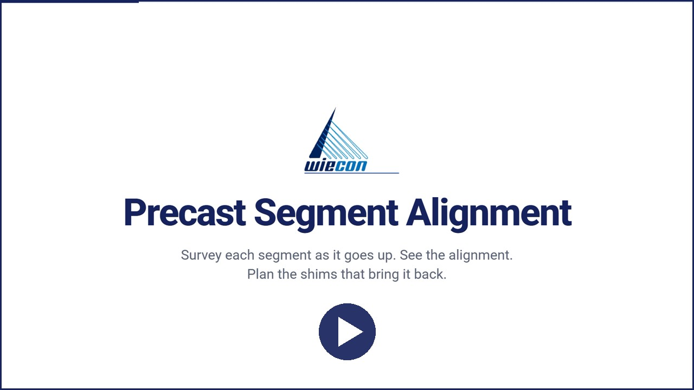
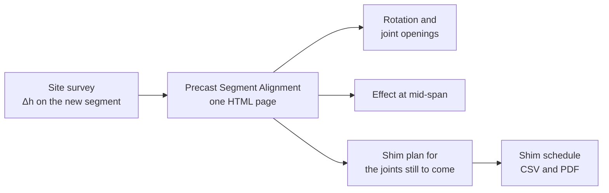
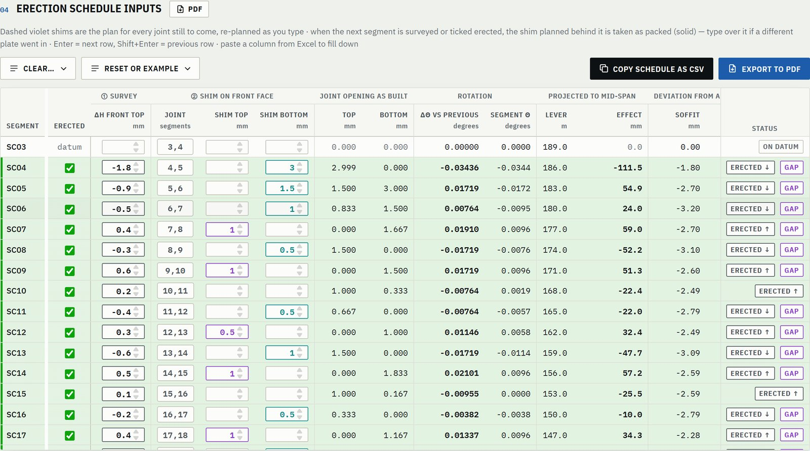
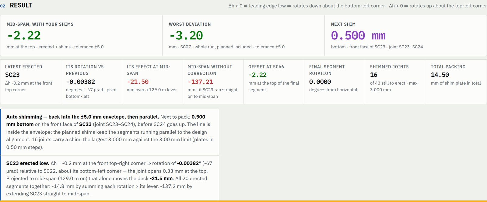
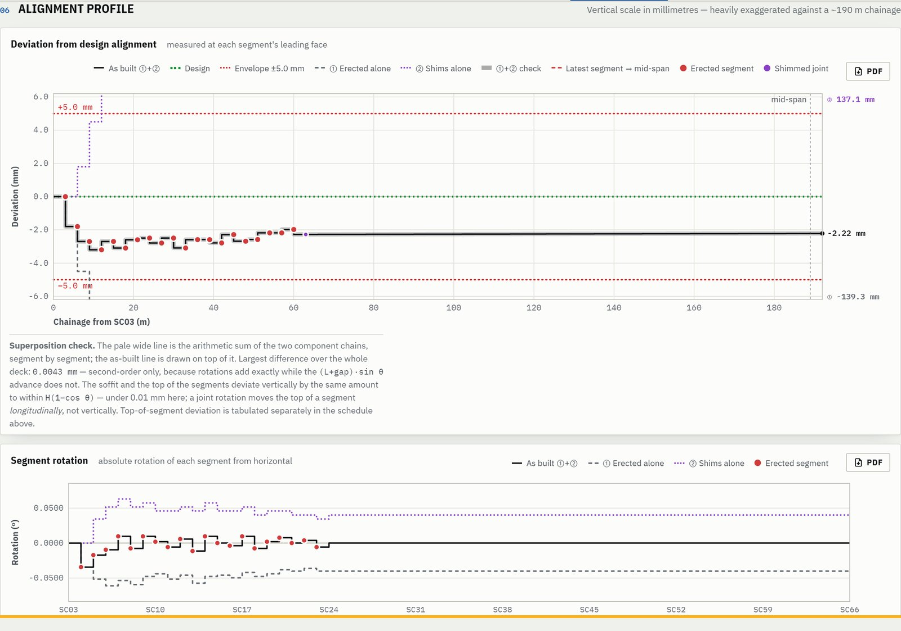
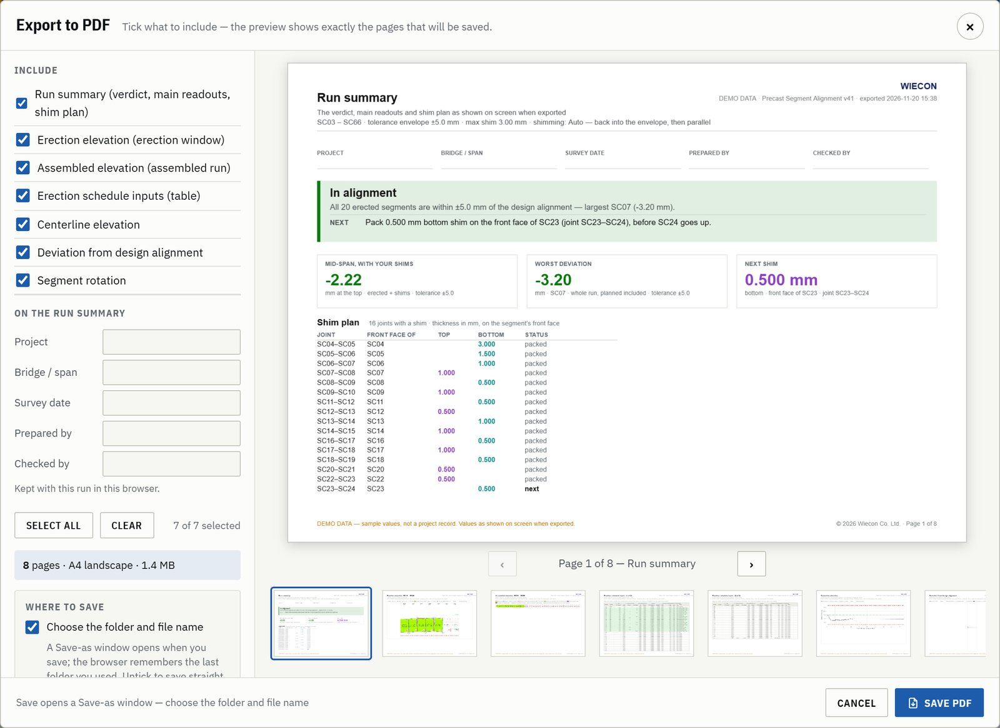
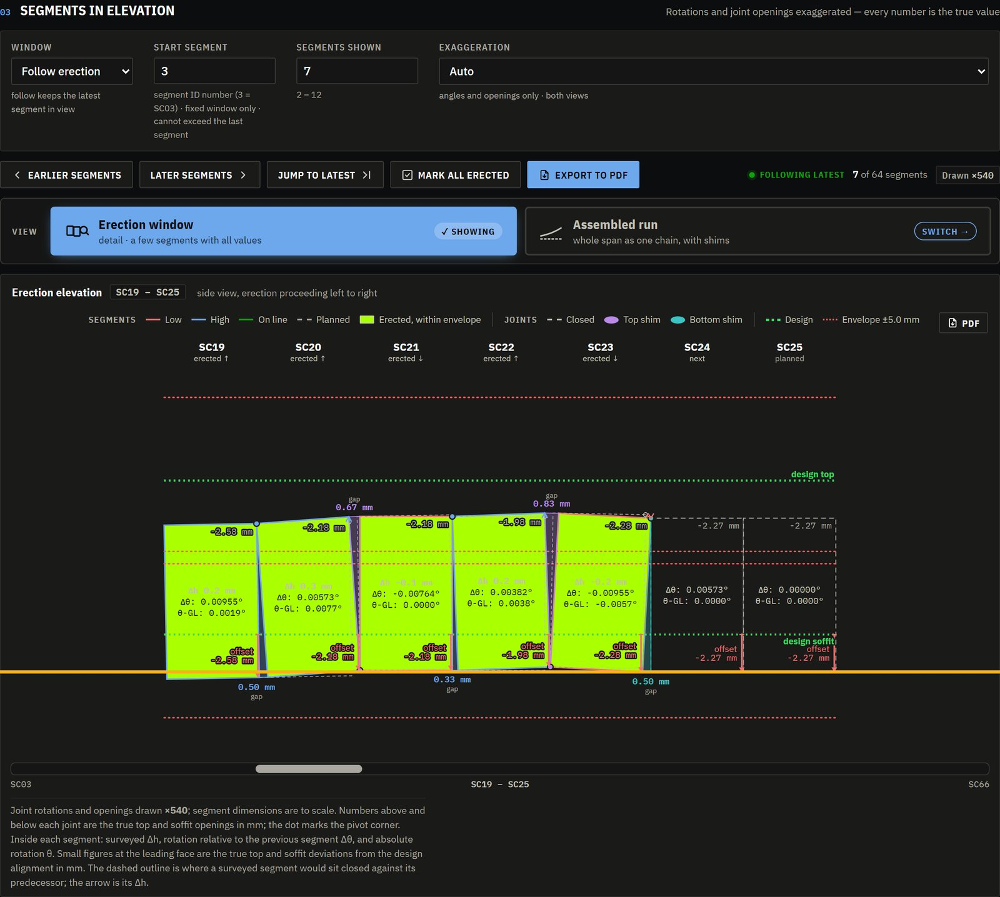

**Keeps a precast bridge deck on line while it's being built, one segment at a time.**

A short 52-second video of the app in action (recorded on v36; the screenshots below are from v41). Click the image, then hit play on the GitHub file page. Music: <i>Motivational Upbeat Corporate</i>, a royalty-free background track.

This repo is just a showcase, the source code itself is private. All the segments, survey values and shims you see in the video and screenshots come from the app's built-in <b>Demo</b> run, so there's no real project data in here.

> [!CAUTION]
> ### Proprietary software. Not open source.
>
> **Copyright © 2026 Immanuel Wiessler and Wiecon Consultants Taiwan. All rights reserved.**
>
> This repository only holds documentation. The source code for Precast Segment Alignment is private. If you'd like to know more about the project, email me at **[im.wiessler@gmail.com](mailto:im.wiessler@gmail.com)**.

 

<table>
<tr><td><b>Input</b></td><td>The level difference (Δh) surveyed on each new segment, plus the basic geometry of the run</td><td>typed in by hand, or pasted straight from Excel</td></tr>
<tr><td><b>Output</b></td><td>How much each segment has rotated, how far off the alignment the deck is, and where the shims should go</td><td>graphs, a CSV schedule and an A4 PDF report</td></tr>
<tr><td><b>Stack</b></td><td>A single HTML file with plain JavaScript, SVG graphs and its own PDF writer</td><td>no server, nothing to install</td></tr>
<tr><td><b>Platform</b></td><td>Chrome or Edge on a Windows PC</td><td>also works on a tablet or phone on site</td></tr>
</table>

 

| # | Section | What's in it |
| :---: | --- | --- |
| 01 | [Why this exists](#01-why-this-exists) | The problem it solves |
| 02 | [Features](#02-features) | What the app can do |
| 03 | [Screenshots](#03-screenshots) | The main screens, using the Demo run |
| 04 | [Architecture](#04-architecture) | How it all fits into one HTML file |
| 05 | [Example workflow](#05-example-workflow) | What using it looks like for one segment |
| 06 | [What it doesn't do](#06-what-it-doesnt-do) | Things that are out of scope |
| 07 | [Changelog](#07-changelog) | The bigger updates so far |
| 08 | [Copyright](#08-copyright) | What this repo is and isn't |

 

---

## 01. Why this exists

 

Precast segmental bridges are built one segment at a time, with each new segment fixed to the end of the last one. No segment ever goes in perfectly, it always sits a tiny bit off the design line. On its own that's nothing, but every segment after it inherits the error, so it keeps growing the further out you go.

To give an idea of how quickly that adds up, in the Demo run a single segment that was surveyed only **0.2 mm** low ends up rotated by about **0.004°**. Carry that 129 m out to mid-span and it's already **21.5 mm**. If nobody corrects it, the deck finishes **137 mm** off at mid-span. With the shims the app suggests, it finishes just **2.2 mm** off, which is well inside the ±5 mm tolerance.

Before this, the team worked these numbers out segment by segment in a spreadsheet. The app does it all on one page: you enter a survey value, it recalculates the whole run, redraws it, and tells you where the next shim should go.

---

## 02. Features

**1.**  
You type in the surveyed Δh for each segment, or paste a whole column from Excel. From that the app works out how each segment has rotated (and around which corner), how wide the joints have opened at the top and bottom, and how far every segment is from the design alignment.

**2.**  
Each rotation is carried forward to mid-span, so you can see straight away what a fraction of a millimetre on site actually means for the finished deck.

**3.**  
The app plans a shim for every joint that hasn't been built yet. If the deck has drifted outside the tolerance, it first steers it back in, and after that it keeps the segments running parallel to the design line. It never suggests a shim thicker than the maximum plate, and it rounds every shim to the plate sizes you actually have. You can also enter the shims yourself if you'd rather.

**4.**  
There are two side views. One zooms in on the few segments around the latest one and shows every value on the drawing. The other shows the whole run as one chain. The rotations are exaggerated in the drawings so you can actually see them, but the numbers are always the real values. Segments that are built and within tolerance turn green.

**5.**  
A bar at the top tells you right away whether every built segment is within ±5 mm, and which one is the furthest off. It also names the next shim to pack, and in which joint, before the next segment goes up. If a survey value looks wrong or impossible, the app flags it rather than quietly using it.

**6.**  
You can export any of the graphs and the erection schedule to an A4 PDF, and preview the pages before saving. The PDF opens with a one-page run summary (the verdict, the main numbers and the shim plan, with room for the project name and who checked it), and it's made inside the page itself, so it works offline and doesn't need the print dialog. The schedule can also be copied as a CSV.

**7.**  
The first time you open it, the app starts on the **Demo**; after that it opens in **View only**, so nobody can change a live run by accident. To make changes you switch to **Edit** and enter a password (it's stored as a SHA-256 hash, never as plain text). Edit locks itself again after 15 idle minutes, and an optional short PIN lets you pick up where you were in the same browser for 12 hours. There's also a **Demo** mode with a sample run you can play around with freely, since nothing in it gets saved. Press *Play erection* and it builds the sample bridge segment by segment.

**8.**  
Everything you enter is saved automatically in the browser. The app also has a built-in step-by-step guide, light and dark themes, and a layout that works on a phone on site as well as on a desktop in the office. On a phone, a **Site entry card** takes you through each segment in site order: pack the shim, then enter the survey, with a large Low ↓ / High ↑ choice for the sign (a phone's number keypad has no minus key), and it tells you straight away whether you're still within tolerance.

---

## 03. Screenshots

 

**The erection window.** A close-up of the segments around the latest one, with the survey, the rotation, the joint openings and the planned shims drawn right on the segments.

**The erection schedule.** One row per segment, with the survey, the shims, the joint openings, the rotation, the effect at mid-span and how far it is from the alignment.

**The result.** Three main readouts up top (where mid-span ends up with your shims, the worst deviation and the next shim to pack), then the latest segment and what it does at mid-span, where the deck would end up without any correction, and how much shim plate the plan needs in total.

<table>
<tr>
<td align="center"> <b>Assembled run</b>: the whole span in one view.</td>
<td align="center"> <b>Alignment profile</b>: how far off each segment is.</td>
</tr>
<tr>
<td align="center"> <b>Export to PDF</b>: pick what to include, check the preview, save.</td>
<td align="center"> <b>Dark theme</b>: same views, easier on the eyes.</td>
</tr>
</table>

---

## 04. Architecture

    

The whole app is one HTML file of about 530 KB. There's no server and no install: you copy the file onto a PC and open it.

| Part | What it does |
| :--- | :--- |
| **Calculation** | Works out the rotations, joint openings, the effect at mid-span and the distance from the design alignment, and redoes the whole run every time something changes. |
| **Shim planner** | Plans the shims for the joints still to come: first back inside the tolerance, then parallel to the design line, using only plate sizes you actually have. |
| **Drawings** | The erection window, assembled run, centerline elevation and the deviation and rotation charts, all drawn as SVG in both light and dark themes. |
| **PDF export** | A small PDF writer built into the page. It draws proper A4 pages with real text rather than screenshots, and saves them through the browser's Save As window where that's available. |
| **Storage** | Your inputs are kept in the browser's local storage. The edit password and the resume PIN are only ever stored as SHA-256 hashes. |
| **Promo video** | The 52-second video at the top was made with HyperFrames, using screens from the app's Demo run. |

---

## 05. Example workflow

1. **Set up the run.** Enter the first and last segment, the segment length and depth, the distance to mid-span, the tolerance, the thickest shim allowed and the plate sizes.
2. **Survey the new segment.** Type its Δh into the erection schedule and tick **Erected**, or on a phone use the Site entry card.
3. **Check the result.** The rotation, the effect at mid-span and whether you're still within tolerance all update immediately.
4. **Pack the next shim.** Just below the result, the app tells you which shim to put in next, and in which joint, before the next segment goes up.
5. **Share it.** Export the graphs and the schedule to PDF, or copy the schedule as a CSV.

---

## 06. What it doesn't do

| Not included | Why |
| :--- | :--- |
| Surveying | The level difference is still measured on site. You type it in or paste it from Excel |
| Horizontal (plan) alignment | The app only works in elevation: levels, rotations and shims along the run |
| Sharing one run between several people | Each browser keeps its own run. To share results, use the CSV and PDF exports |

---

## 07. Changelog

 

The bigger updates, newest first.

| Version | Released | What changed |
| :--- | :--- | :--- |
| **v41** | 2026-11-20 | A tidier navigation bar: everything in it the same height and style, the current section underlined, and *Export to PDF* always in view on a narrow screen |
| **v40** | 2026-11-20 | The Site entry card follows the order of work on site (pack, then survey), with a large Low ↓ / High ↑ sign choice and an in/out of tolerance verdict; a 12-hour PIN; a set-up card for a new run |
| **v39** | 2026-11-20 | Warnings about doubtful values in the Site entry card, a small status card while you scroll on a desktop, and Undo in the Run data menu |
| **v38** | 2026-11-20 | The status bar names the next shim; three main readouts; the Site entry card on phones; the resume PIN; a run summary page at the start of the PDF |
| **v37** | 2026-11-20 | Easier to read on site: darker labels, larger small text, the status bar first on phones and bigger buttons to tap |
| **v36** | 2026-10-15 | Photos added to the credits card |
| **v34** | 2026-10-15 | New credits card |
| **v33** | 2026-10-14 | View only, Edit (with a password) and Demo modes, plus *Play erection* |
| **v32** | 2026-10-13 | Bigger Wiecon logo and a page footer |
| **v30** | 2026-10-13 | PDF preview before saving, and a navigation bar that stays at the top |
| **v28** | 2026-10-13 | The erection schedule can be exported to PDF as a proper table |
| **v26** | 2026-10-13 | Every graph can be exported to PDF, straight from the page |
| **v24** | 2026-10-10 | Segments within tolerance are filled bright green |
| **v21** | 2026-10-09 | New button to clear the shims of segments not built yet |
| **v17** | 2026-10-08 | Auto shimming: back within tolerance first, then parallel |
| **v16** | 2026-10-08 | *Erected* ticks, a joint column, and the segment you're editing is highlighted |
| **v13.5** | 2026-10-07 | Fixes from a round of deliberately trying to break it |
| **v7** | 2026-10-05 | New view showing the assembled segments in elevation |
| **v4** | 2026-09-23 | Switching to manual shimming clears the shim table |
| **v1** | — | The first version of the calculator |

---

## 08. Copyright

> [!IMPORTANT]
> **Proprietary and confidential. This is not open-source software.**

Copyright © 2026 Immanuel Wiessler and Wiecon Consultants Taiwan. All rights reserved.

I've made this repository public so people can see what Precast Segment Alignment does. It doesn't contain any source code, and making it public doesn't give anyone a licence to the software. If you have questions or want to ask for permission, email me at **[im.wiessler@gmail.com](mailto:im.wiessler@gmail.com)**.
